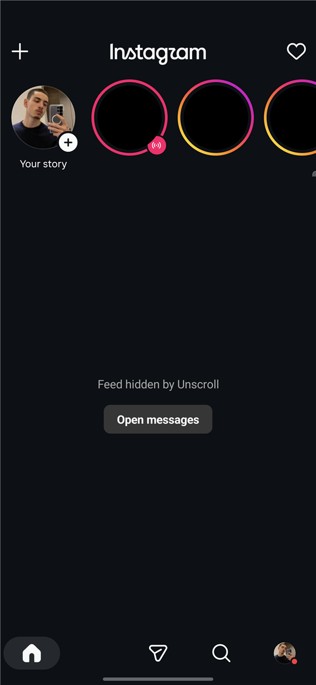
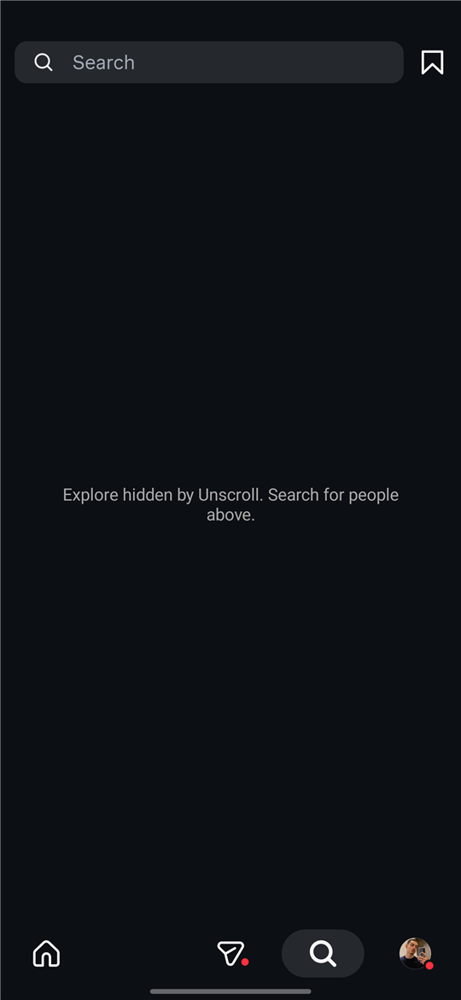
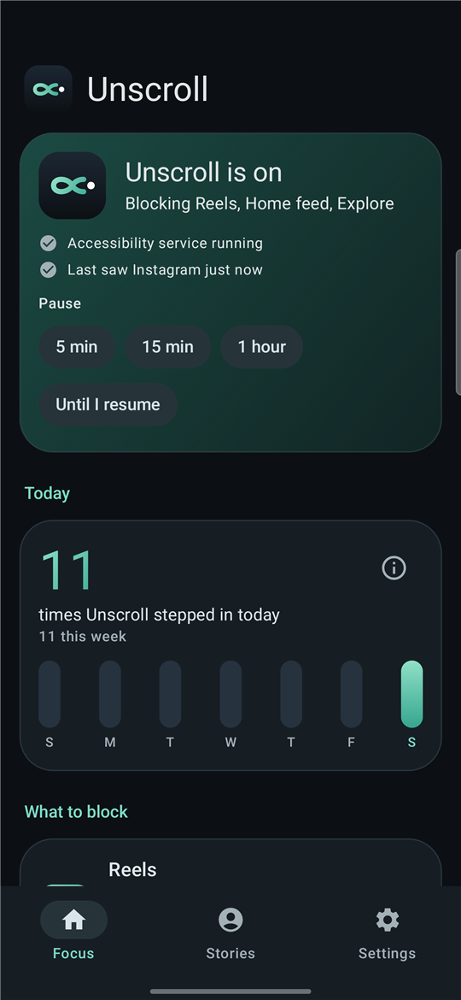
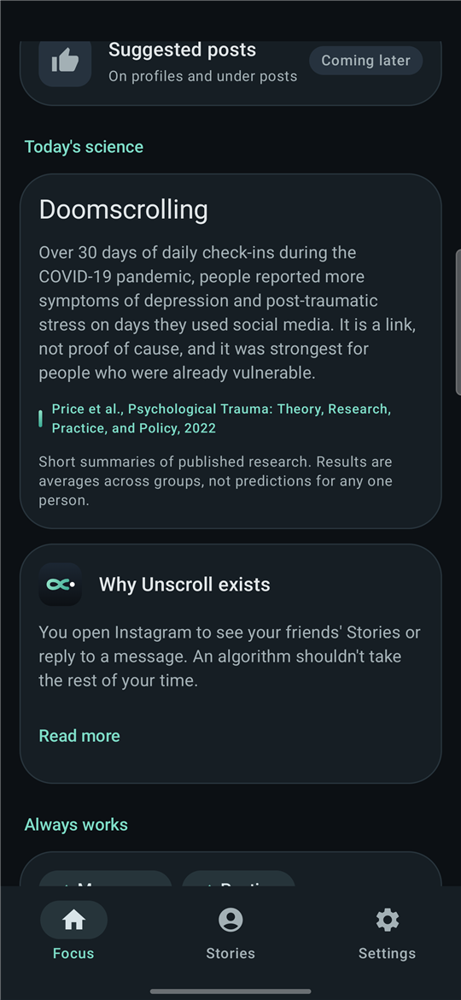
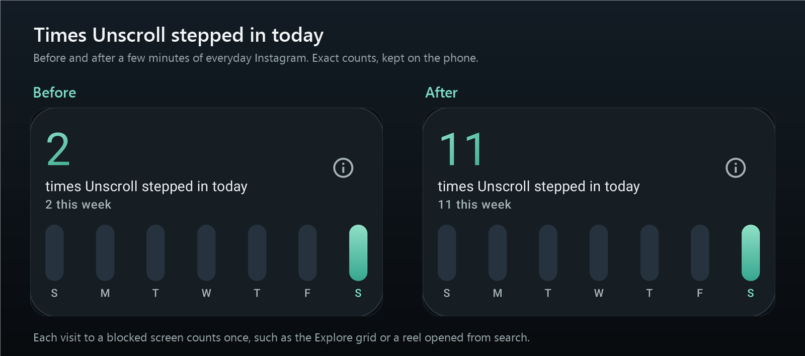

<p align="center">
  
</p>

<h1 align="center">Unscroll</h1>

<p align="center"><b>A focus mode for Instagram on Android.</b><br>
Keep your messages, posting and profile. Lose Reels, the Home feed and Explore.</p>

<p align="center">
  <a href="https://github.com/GhaziAldweik/unscroll/releases/latest">Download the APK</a> ·
  <a href="#why">Why</a> ·
  <a href="#install">Install</a> ·
  <a href="#how-it-works">How it works</a> ·
  <a href="#privacy">Privacy</a> ·
  <a href="#roadmap">Roadmap</a>
</p>

---

**Status:** 1.1.0, in daily use by its developer since November 2026, tested on one phone ([details](#compatibility-and-known-limitations)). It doesn't modify Instagram, ask for your login or use any Instagram API. It watches which Instagram screen is showing and covers or skips only the parts you switch off.

## Why

You open Instagram to see your friends' Stories or reply to a message. The feed is built to keep you there: it never ends, and the next swipe might always be the good one. An algorithm shouldn't take the rest of your time. Unscroll keeps what you came for and removes the endless parts, so you get back your time and a clearer mind.

Research links heavy daily social media use, especially through bad news ("doomscrolling"), to more symptoms of depression and post-traumatic stress (Price et al., 2022). Bright screens at bedtime worsen sleep (Chang et al., 2015), and attention on a screen now averages about 47 seconds before a switch (Mark, 2023). And uncertain rewards, the kind a feed delivers, are especially good at engaging the brain's dopamine system (Fiorillo, Tobler & Schultz, 2003).

| Instagram Home | Instagram Search | Unscroll | Today's science |
|:---:|:---:|:---:|:---:|
|  |  |  |  |
| Feed covered, Reels button gone | Explore grid covered | What's blocked, and how often it stepped in | A new research note every day |

<sub>Other people's Stories are blacked out in these screenshots for their privacy; Unscroll itself leaves Stories as they are.</sub>

## What it does

| You switch off | What happens |
|---|---|
| **Reels** | The Reels button is hidden, and swiping across to the Reels tab jumps to your messages. Reels opened anywhere else (Explore, search, profiles, posts) close. |
| **Home feed** | Everything below the Stories row is covered. When Instagram opens on Home, it goes to your messages instead. |
| **Explore** | The grid under the search box is covered. Searching for people still works. |
| **Search result pages** | Pages of posts for a hashtag, place or word close and go back to the search box. |

**Always kept:** messages, posting, your profile, Stories, reels a friend sends you, and your Saved reels. Reels from a chat or from Saved play **one at a time**: swiping on to the next one closes it, because that is where the recommendations start.

Every rule is off until you switch it on. Each card shows whether the rule is actually working ("last acted 2 min ago"), not just whether it is switched on. **Settings → Diagnostics → Check protection** checks everything it depends on and says how to fix each problem.

**Step-ins.** The Focus tab counts how many times Unscroll stepped in today, with a bar per day for the last week. Each visit to a blocked screen that Unscroll covered or left counts once. These are exact counts, not estimates of time saved: Unscroll can't know how long you would have scrolled.

<p align="center">
  
</p>

**Today's science.** A short note on the research about scrolling, a different one each day, each with its source: 18 studies, built into the app, so it needs no internet.

**Coming later:** hiding Stories from chosen people (the list is already in the Stories tab, but nothing is hidden yet) and hiding suggested posts.

## Pause or turn it off

- **Pause** on the Focus tab: 5 min, 15 min, 1 hour or until you resume.
- The **Unscroll tile** in Quick Settings: one tap pauses for 15 minutes, another resumes.
- **Turn off Unscroll** in Settings → Maintenance, or switch it off in Android's Accessibility settings.

## Install

Unscroll is not on the Play Store. Install it from the APK on your phone; you don't need a PC.

1. On your phone, open the [latest release](https://github.com/GhaziAldweik/unscroll/releases/latest) and download `unscroll-<version>.apk`.
2. Open the downloaded file and allow your browser or file manager to install apps when Android asks.
   On Samsung phones, **Auto Blocker** may refuse the install: turn it off for the install in **Settings → Security and privacy → Auto Blocker**.
3. Open **Unscroll**. A short introduction explains what it does, then the **Settings** tab walks you through setup:
   1. **Accessibility:** Settings → Accessibility → Installed apps → **Unscroll** → switch it on.
      If Android says it's a **restricted setting**: open **Settings → Apps → Unscroll**, tap **⋮** (top right) → **Allow restricted settings**, then try again.
   2. **Battery:** Settings → Apps → Unscroll → Battery → **Unrestricted**, so the phone doesn't put it to sleep.
4. Back in Unscroll, switch on what you want to block on the **Focus** tab.

To update, install the newer APK over the old one; your settings stay.

> **Android's developer verification.** Google is gradually requiring apps installed outside the Play Store to come from registered developers, country by country. Where that applies, installing this APK may need extra steps or may be blocked.

## Compatibility and known limitations

**Tested on:**
- Samsung Galaxy S25 Ultra, Android 17 (One UI 9.0)
- Instagram 455.0.0.51.72, with Instagram's language set to **English**

**Needs:** Android 14 or newer (minSdk 34).

**Known limitations:**
- **Instagram updates.** Unscroll recognises Instagram's screens by the internal names of their on-screen elements. Instagram renames these from time to time, and layouts differ between versions and A/B tests. When a screen is not recognised, Unscroll does nothing on it rather than guessing; **Check protection** shows this. Messages are never blocked by a wrong guess.
- **Other phones and interface languages** have not been tested. Screens are recognised by element names, not by their text, so the language should not matter, but that is unconfirmed.
- **A brief flash.** Covers follow what Instagram draws, so part of a screen can show for a split second before it is covered.
- **Not built yet:** hiding Stories from chosen people, and hiding suggested posts on profiles and under posts.
- **Android's own reminders.** Android occasionally reminds you that an app has accessibility access; that is expected.
- **Battery savers** can stop the service. Set battery use to **Unrestricted** (the setup checklist shows whether it is).

## Privacy

- **No internet permission.** The app has no way to send anything on its own. Every permission it asks for is in [`AndroidManifest.xml`](app/src/main/AndroidManifest.xml), and CI fails if a library ever adds internet access.
- **No account and no login.** No backend, no analytics, no tracking, no cloud sync. Settings stay on your phone.
- **Step-ins are just numbers:** one count per day, kept on the phone for two weeks. Nothing about what you looked at is stored.
- It reads the **names and positions** of Instagram's on-screen elements, never your messages, captions or images.
- It asks for no other permissions: no "display over other apps", notifications, contacts, storage or location. Its covers are drawn by its accessibility service.
- **Diagnostics → Inspector** (off by default) records only element names and screen labels, and only leaves the phone if you tap Share.

The accessibility service is the only Android mechanism that lets an app see which screen another app shows and act on it. Unscroll uses it for Instagram only (`packageNames="com.instagram.android"`), and does not claim to be an accessibility tool.

## How it works

```
Instagram window ──events──▶ FocusAccessibilityService
                                │  looks up a handful of view IDs (rules/InstagramRules.kt)
                                ▼
                         ScreenClassifier ──▶ HOME, REELS_TAB, REEL_VIEWER, DM_THREAD, …
                                │
             NavigationHistory ─┤  (where a reel was opened from, whether you swiped on)
                                ▼
                          PolicyEngine ──▶ Decision: covers to show, and a tap or Back
                                │
                                ▼
          CoverOverlay (accessibility overlays)   ·   tap the DMs tab / press Back
```

- **Pure Kotlin policy.** `PolicyEngine`, `NavigationHistory` and the guards contain no Android code. They are unit-tested against screen signatures recorded on a real phone (`app/src/test/resources/fixtures/`).
- **One file of Instagram IDs.** Every Instagram view ID lives in `rules/InstagramRules.kt`, so an Instagram update means editing one file. The built-in Inspector records new signatures.
- **Covers come first.** Invisible patches over the Home and Search tab buttons put the cover up the moment you press them, before Instagram has drawn the feed.
- **Guards throttle, never trap.** If a Back or tap keeps repeating, or a cover keeps flickering, Unscroll backs off for a while instead of fighting Instagram. It never covers the whole screen, and it takes its overlays down whenever Instagram loses focus, so the notification shade and the Pause tile stay reachable.

## Technologies

| Area | Used |
|---|---|
| Language | Kotlin 2.4 |
| UI | Jetpack Compose with Material 3, edge-to-edge, light and dark themes |
| Android | `AccessibilityService` (window and view-ID lookups, gestures, `TYPE_ACCESSIBILITY_OVERLAY` covers), Quick Settings `TileService` |
| Storage | Jetpack DataStore (Preferences), on the phone only |
| Build | Gradle 9.6 with version catalog, Android Gradle Plugin 9.5, compileSdk 37, minSdk 34 |
| Tests | JUnit 4: 108 unit tests for the classifier, the policy engine, navigation history, the guards, the Inspector and the step-in counts; the classifier and policy tests replay screens recorded on a real phone |
| CI | GitHub Actions: tests, build, and a check that the merged manifest never requests `INTERNET` |

Runtime dependencies: AndroidX (Compose, DataStore, core) and the Kotlin standard library and coroutines; nothing else.

## Roadmap

- [ ] **Hide Stories by person:** apply the hidden list in the Stories row and skip those Stories in the viewer, with a "Hide this person" button inside a Story.
- [ ] **Hide suggested posts** on profiles and under posts.
- [ ] **Scheduled Focus Mode:** for example only on weekday evenings, checked on each screen change, with no alarms or background work.
- [ ] **Export and import settings** through Android's file picker, with no new permission.
- [ ] **Wider testing:** more phones, more Instagram versions and other interface languages.
- [ ] A clearer warning when an Instagram update stops screens from being recognised.

Ideas and bug reports are welcome in [Issues](https://github.com/GhaziAldweik/unscroll/issues).

## Build from source

Requirements: JDK 21 and the Android SDK (platform 37).

```sh
./gradlew testDebugUnitTest assembleDebug
```

The APK is in `app/build/outputs/apk/debug/`. For release builds signed with your own key, copy `keystore.properties.example` to `keystore.properties` and fill it in. Both files are kept out of git.

## Disclaimer

Unscroll is an independent project. It is not affiliated with, endorsed by or sponsored by Meta or Instagram. Instagram is a trademark of Meta Platforms, Inc. Unscroll changes nothing on Instagram's servers and nothing inside the Instagram app; it only draws over it on your own phone. Use it at your own risk; see the [licence](LICENSE).

## Licence

[MIT](LICENSE) © 2026 Ghazi Dweik
